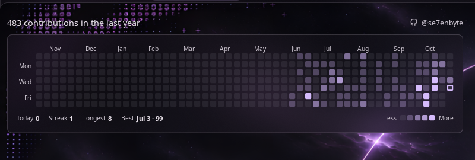

# Noctalia GitHub Heatmap

A [Noctalia](https://noctalia.dev) desktop widget that shows your GitHub contribution graph on the wallpaper, in your
shell's theme colors.



- GitHub-style week grid with month labels, streak stats and a Less/More legend
- Theme-aware (no hard-coded colors), translucent card, smooth fade-in when data changes
- Last 5 to 53 weeks, optional month calendar view
- Data via the GitHub CLI (`gh`), cached locally, refreshed every 15 to 60 minutes

## Install

Requires Noctalia and the GitHub CLI (`gh auth login`).

```sh
git clone https://github.com/se7enbyte/noctalia-github-heatmap
cp -r noctalia-github-heatmap/github-heatmap ~/.local/share/noctalia/plugins/
noctalia msg plugins enable se7enbyte/github-heatmap
noctalia msg desktop-widgets-edit   # add "GitHub Heatmap" and drag it into place
```

Full documentation: [github-heatmap/README.md](github-heatmap/README.md).

## License

MIT
